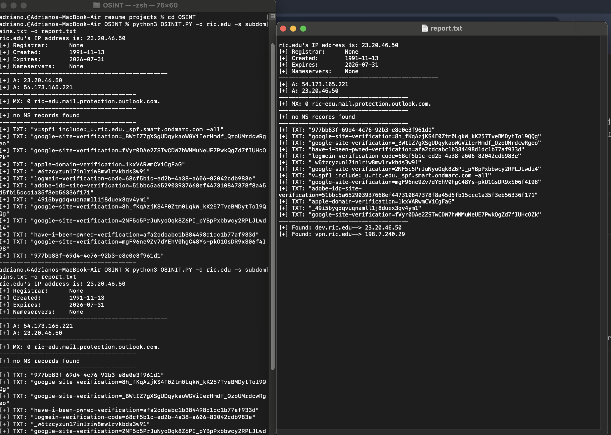
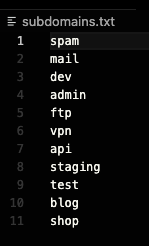

# Domain OSINT

A domain OSINT / reconnaissance tool in Python. Gathers IP, WHOIS, DNS records and enumerates subdomains for a target domain.

## Why i built it

I found OSINT very interesting and i thought it would also help my resume, also to further develop my Python skills.

## What it does

- Resolves a domain's IP address.
- Pulls WHOIS information.
- Looks up DNS records.
- Enumerates subdomains from a wordlist.
- Optional logging to a file.

## How to run it

```bash
python3 OSINT.PY -d example.com -s subdomains.txt -o results.txt
```


Arguments:

- `-d` / `--domain` — the target domain
- `-s` / `--subdomain` — path to a subdomain wordlist
- `-o` / `--output` — file to save results (optional)

Dependencies:

```bash
pip install python-whois dnspython
```

## What i learned / Limitations

- What WHOIS is and what information it reveals about a domain.
- How DNS works and what different record types mean (A, MX, NS, TXT).
- How to use the python-whois and dnspython libraries.
- Only finds subdomains that are in the wordlist.
- Subdomain file is required.

## Files

- `OSINT.PY` - main script
- `subdomains.txt` - wordlist of common subdomains to check
- `report.txt` - output report (generated when using -o flag)

## Disclaimer

This tool is for educational purposes only and should not be used to gather information of a domain without written permission.